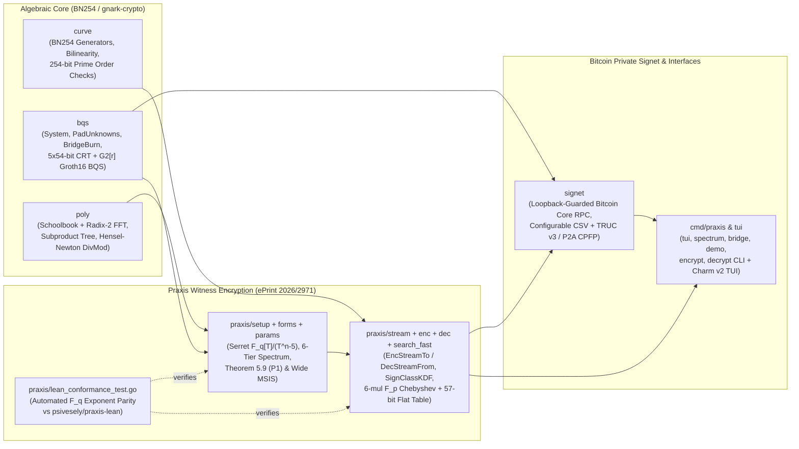
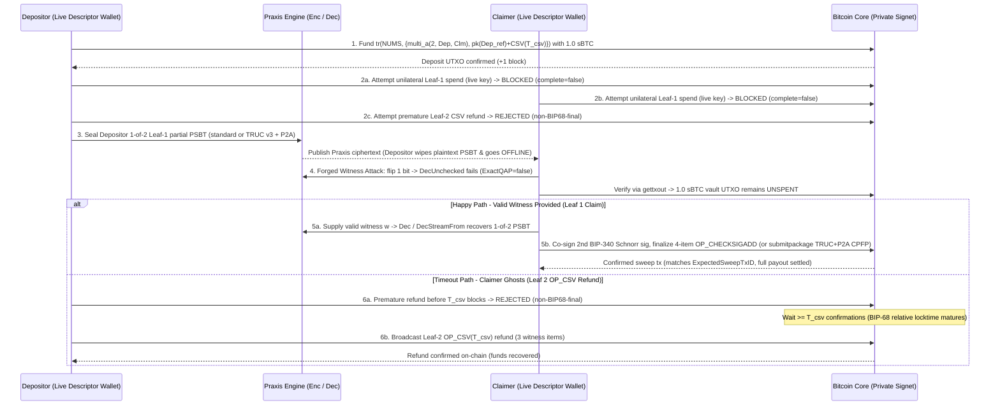

# Practical BN254 Witness Encryption for Zero-Soft-Fork Bitcoin Taproot Vaults

### Compact $\mathbb{G}_2[r]$-Subgroup-Checked Groth16 Verifier BQS, Streaming Table-4 Execution, and Two-Leaf TRUC v3 / P2A Taproot Vaults in `praxis-demo` (`v0.4.0`)

> **Document Status:** Technical Whitepaper — `praxis-demo` `v0.4.0`  
> **License:** Apache-2.0 (Standalone Public Research Prototype)  
> **Cryptographic Basis:** Tse, Vanjani, and Vesely, *"Praxis: Practical Witness Encryption for NP"* (IACR ePrint 2026/2971) and [`psivesely/praxis-lean`](https://github.com/psivesely/praxis-lean); Novakovic and Eagen (IACR ePrint 2024/640); Vanilla Bitcoin Taproot, Miniscript, and TRUC / Pay-to-Anchor (`BIP-340`, `BIP-341`, `BIP-342`, `BIP-68`, `BIP-112`, `BIP-431`)  
> **Security Notice:** **`praxis-demo` is an unaudited research and educational prototype.** Interactive tiers (`Toy` / `Advanced`) and the interactive Signet `bqs.BridgeBurn` predicate run far below cryptographic security parameters, no arithmetic is constant-time hardened, and mainnet RPC ports (`8332`, `8333`, `8382`, `8383`) are hard-refused in code. **Do not protect real data or Bitcoin mainnet funds with this software.**

---

## Abstract

Bitcoin's base layer intentionally restricts Script expressiveness to simple signature and timelock predicates, creating a longstanding tension for trust-minimized bridges, conditional vaults, and Layer-2 exit protocols: enforcing arbitrary succinct-proof statements on Layer 1 traditionally demands either unactivated Bitcoin soft-forks (such as `OP_CAT` or new pairing opcodes), federated multisig custody, or optimistic challenge-response games requiring continuous online watchtowers and multi-round dispute windows.

**Witness encryption for NP** resolves this tension without touching Bitcoin consensus. Rather than verifying a SNARK inside Bitcoin Script, a depositor locks funds in a standard two-leaf Taproot output (`tr(NUMS, {multi_a(2, Depositor, Claimer), and_v(v:pk(Depositor_refund), older(T_csv))})`), pre-signs a 1-of-2 partial PSBT spending Leaf 1 to the claimer, and **witness-encrypts** that partial PSBT under a mathematical statement $S$—then wipes the plaintext PSBT and goes offline. Anyone holding a valid witness $w$ for $S$ decrypts the depositor's Schnorr signature off-chain, co-signs the second key, and settles in a single ordinary Tapscript transaction (optionally fee-bumped via a `BIP-431` TRUC v3 + Pay-to-Anchor `P2A` CPFP child without invalidating the depositor's pre-signature); if no valid witness is ever produced, the depositor reclaims funds cleanly through Leaf 2 once `T_csv` blocks confirm.

This paper documents the complete, executable Go implementation in `praxis-demo` (`v0.4.0`) of **Praxis** (Tse, Vanjani, and Vesely, ePrint 2026/2971) over BN254 (`gnark-crypto`), spanning four concrete engineering results:

1. **Automated `praxis-lean` Conformance & Parameter Spectrum (`Tiers 1–6`):** Exact Figures 9 and 10 BN254 algebra with automated $\mathbb{F}_q$ exponent conformance against `psivesely/praxis-lean`, Theorem 5.9 `(P1)` and wide Module-SIS admissibility enforcement, `SignClassKDF` unitary conjugation invariance, and Section 6.3's 6-multiplication $\mathbb{F}_p$ Chebyshev recurrence search.
2. **Single-Pass Streaming Disk Engine (`praxis/stream.go`):** `EncStreamTo` and `DecStreamFrom` eliminate the $O(nN)$ dense ring-forms matrix ($\sim 57\text{ GiB}$ at Table 4, $N = 391{,}693$) and in-memory ciphertext point arrays, streaming full Table-4 ring, grid, and chunk geometry ($n = 4{,}608$, $6{,}912$ cells, $J = J' = 11$, admissible $N = 4{,}608$) to a **`120.6 MiB`** disk file in **`15.2 MiB`** live Go heap (`HeapAlloc`).
3. **Compact, $\mathbb{G}_2[r]$-Subgroup-Checked Universal BN254 Groth16 Verifier BQS (`bqs/fp_bqs.go`, `bqs/groth16_bqs.go`):** A complete non-native BN254 optimal Ate pairing verifier compiled into a Boolean Quadratic System over $\mathbb{F}_q$ using **5×54-bit `CRT(2^270, q)`** arithmetic, compile-time adversarial Boolean range proofs, direct affine Miller-loop lines, projective $-\delta$ line pairs, Novakovic–Eagen folded final exponentiation, and—new in `v0.4.0`—a **complete in-BQS $\mathbb{G}_2[r]$ prime-order subgroup check on `proof.Bs`** (23-factor batched non-zero chord denominators + Frobenius endomorphism equality $\Phi_{\text{Ate}}(B_s) = \mathcal{O}$). Relative to `v0.3.1`, `v0.4.0` cuts Boolean unknowns $N$ from `3,064,950` to **`2,411,777`** (`-21.3%`; only `+1.35%` over `v0.3.2` for full $\mathbb{G}_2[r]$ soundness), constraints $n_c$ from `13,884` to **`11,461`** (`-17.5%`; `+1.42%` over `v0.3.2`), $F_{\max}$ from `154` ($\nu = 256$) to **`60`** ($\nu = 64$, `-61.0%`), and the QAP evaluation domain $D$ from `6,619,256` ($|\mathcal{H}| = 2^{23}$) to **`3,145,283`** ($|\mathcal{H}| = 2^{22}$, **`-52.5%`**), compiling in **`409 ms`** (`~5.2×` faster than `v0.3.1`).
4. **Live Private Signet Two-Leaf Taproot Vaults with Configurable `OP_CSV` & TRUC v3 / P2A CPFP (`signet/signet.go`):** End-to-end verification on Bitcoin Core Private Signet (`signetchallenge=51`) with both parties' private keys kept live—confirming unilateral Leaf-1 spends fail for both parties, configurable `OP_CSV` timelocks reject premature refunds with `non-BIP68-final` (verified at `CSV = 6` and `CSV = 12` settling at block `#6778`), forged witnesses fail decryption while leaving the UTXO unspent, and `BIP-431` TRUC v3 `0`-fee pre-signed Leaf-1 parents (`175 vB`, rejected standalone with `"min relay fee not met"`) settle atomically via `submitpackage` with Claimer's `153 vB` `P2A` (`51024e73`) CPFP child (`15,000` sat package fee / `45.73 sat/vB`, empty P2A witness `[]`), delivering the full `100,000,000` sat (`1.00000000 sBTC`) payout across **`7/7` consecutive live Signet runs**.

---

## 1. Executive Summary

Witness encryption encrypts a payload directly to an NP statement $S$ without generating a public/private keypair: decryption succeeds if and only if the decryptor supplies a witness $w$ satisfying $S$. While theoretical witness encryption constructions historically relied on impractical multilinear maps or indistinguishability obfuscation, **Praxis** (ePrint 2026/2971) achieves concrete, single-pairing-group practicality over BN254 by combining Boolean Quadratic Systems (BQS), coset-packed Quadratic Arithmetic Programs (QAPs), negacyclic ring matrices $M \in R_q^{K \times (\ell+1)}$, Serret extension fields $\mathbb{F}_q[T]/(T^n - c_0)$, a $K_1 \times 3 K_2$ shared-factor grid, and a centered discrete-logarithm search in $\mathbb{G}_T$ sign classes $\{V, V^{-1}\}$.

While the paper's authors formalized correctness and generic-group extractability in Lean 4 (`psivesely/praxis-lean`), Lean's formalization does not emit ciphertexts or execute curve pairings. `praxis-demo` closes that gap with a self-contained Go implementation organized into seven packages (`bqs`, `poly`, `curve`, `praxis`, `signet`, `tui`, `cmd/praxis`):



### Summary of Verified `v0.4.0` Capabilities

| Capability | Package / Entrypoint | Verified Metric or Property |
|---|---|---|
| **`praxis-lean` Algebraic Parity** | `praxis/lean_conformance_test.go` | Bit-for-bit $\mathbb{F}_q$ exponent parity across `Constants`, `Forms`, `Kummer`, `Grid`, `Enc`, `Dec` (`expGroups`), `Keys`, and `Published` (`countG1`/`countG2`). |
| **6-Tier Parameter Spectrum** | `praxis/spectrum.go`, `cmd/praxis spectrum` | Scales cleanly from `Tier 1 Toy` ($n=8, g=2^{20}$) to `Tier 6 Table-4` ($n=4{,}608$, $6{,}912$ cells, $J=J'=11$, $g = 1{,}736{,}375{,}024{,}658{,}487 \approx 2^{50.6}$). |
| **Single-Pass Streaming Disk Engine** | `praxis/stream.go`, `praxis/stream_test.go` | Full Table-4 geometry ($n=4{,}608$, admissible $N=4{,}608$, `SignClassKDF=true`): **`120.6 MiB`** disk file in **`15.2 MiB`** live `HeapAlloc`. |
| **Compact $\mathbb{G}_2[r]$-Checked Groth16 Verifier BQS** | `bqs/fp_bqs.go`, `bqs/groth16_bqs.go` | **`N = 2,411,777`**, **`nc = 11,461`**, **`Fmax = 60`** ($\nu = 64$), **`D = 3,145,283`** ($|\mathcal{H}| = 2^{22}$), compile **`409 ms`**, synth **`515 ms`**, check **`375 ms`**; rejects cofactor attacks (`Q_bad`, prime order `10069 | h2`). |
| **Configurable `OP_CSV` & TRUC v3 / P2A Signet Vaults** | `signet/signet.go`, `signet/signet_test.go` | Live keys retained; unilateral Leaf-1 spends fail; `CSV = 12` rejects `1`/`6`/`11` confs (`non-BIP68-final`) and settles @ `#6778`; `0`-fee `175 vB` TRUC v3 parent + `153 vB` P2A (`51024e73`) CPFP child (`15,000` sat / `45.73 sat/vB`) settles full `1.0 sBTC` via `submitpackage` (`7/7` Signet runs). |

---

## 2. Praxis Construction, `praxis-lean` Conformance & Streaming Disk Engine

### 2.1 Boolean Quadratic Systems & Coset-Packed QAPs

Praxis operates directly on a **Boolean Quadratic System (BQS)** over BN254's scalar field $\mathbb{F}_q$, where $q = 21888242871839275222246405745257275088548364400416034343698204186575808495617 \approx 2^{253.6}$:
$$\sum_{f=1}^{F_t} a_{t,f}(w)\, b_{t,f}(w) = w_0\, c_t(w) \quad \text{for } t \in \{0, \dots, n_c - 1\}, \qquad w_0 = 1, \qquad w_j \in \{0, 1\} \text{ for } j \in \{1, \dots, N\}.$$

Unlike standard R1CS—which allocates one auxiliary variable per multiplication—each BQS constraint sums up to $F_{\max} = \max_t F_t$ bilinear products directly. Following Definitions 4.1 & 4.6 and Lemma 4.7 of ePrint 2026/2971 (`praxis/setup.go`):
- Let $\nu = 2^{\lfloor \log_2 F_{\max} \rfloor + 1}$ be the smallest power of two strictly exceeding $F_{\max}$.
- Inside a radix-2 FFT evaluation subgroup $\mathcal{H} \subset \mathbb{F}_q^*$ (ordered in bit-reversed powers per Section 4.4 when `Fast: true`), each constraint $t$ occupies one coset $\mathcal{K}_t$ of size $\nu$, while $N$ single points $d_1, \dots, d_N$ enforce Booleanity ($w_j^2 - w_0 w_j = 0$), alongside $d_0$ and the key point $\rho$.
- The total QAP domain size is therefore:
  $$D = N + 2 + \nu \cdot n_c, \qquad |\mathcal{H}| = 2^{\lceil \log_2 D \rceil}.$$
  Crucially, **cutting $F_{\max}$ below a power-of-two threshold** shrinks $\nu$ by a factor of $2\times$ or $4\times$, dramatically shrinking $D$ and the FFT domain $|\mathcal{H}|$ (Section 3.4).
- Given a valid Boolean witness $w$, decryption computes unique quotients $h_{\text{key}}, h_{\text{oth}}$ and an allowed remainder $R_w \in \mathbb{F}_q^{< \nu n_c}[X]$ whose coefficients vanish at every multiple of $\nu$, using radix-2 FFTs and Hensel–Newton power-series division (`poly.DivModFFT`, $O(D \log D)$). Any invalid witness destroys exact divisibility (`ExactQAP == false`), preventing target-group cancellation.

### 2.2 Ring Matrix Forms, Serret Extension, Shared-Factor Grid & Admissibility

To tie all $N$ Boolean unknowns into a compact algebraic lattice instance while keeping pairing count small (`praxis/forms.go`, `praxis/params.go`, `praxis/spectrum.go`):

1. **Negacyclic Ring Matrix ($R_q = \mathbb{F}_q[Y]/(Y^{d_R} + 1)$):** A 32-byte random seed expands via SHA-512 (`"praxis-demo/seed" || seed || i || j || s`, reduced mod $q$, bias $< 2^{-258}$) into a matrix $M \in R_q^{K \times (\ell + 1)}$ where $\ell = \lceil N / d_R \rceil$. Packing witness entries $d_R$ at a time produces $n = (K + 1)\, d_R$ linear forms $\varphi_0, \dots, \varphi_{n-1}$ ($\varphi_0(w) = w_0$, $\varphi_1 = \dots = \varphi_{d_R - 1} = 0$).
2. **Serret Extension Field $\mathbb{F}_q[T]/(T^n - c_0)$:** For any even $n \mid (q - 1)$, `newField(n)` finds the least $c_0 \ge 2$ that is a non-$p$-th-power for every prime $p \mid n$. Because $4 \mid (q - 1)$ on BN254, Serret's theorem guarantees $T^n - c_0$ is irreducible. At Table 4 ($n = 4{,}608 = 9 \cdot 2^9$), $c_0 = 5$ and the Frobenius root of order $n$ is the exact 77-digit constant:
   $$\beta = 5^{(q-1)/4608} \bmod q = 15455056031545522072329890326622223210121953105925913337013641664433101999706, \qquad \beta^{2304} \equiv -1 \pmod q.$$
3. **Quadratic Weights & $K_1 \times 3 K_2$ Shared-Factor Grid:** From $z(w) = \sum_{k=0}^{n-1} \varphi_k(w) T^k$, the quadratic weights $U(w) = z(w)\sigma^{n/2 - 1}(z(w))$ and $V(w) = z(w)\sigma^{n/2}(z(w))$ populate $3 K_1 K_2 = 3n / 2$ grid cells ($K_1 \cdot K_2 = n / 2$; at Table 4, $K_1 = 192, K_2 = 12 \implies 6{,}912$ cells) across left legs $k_1 \in [K_1]$ and three right-leg families (`E`, `O`, `V`).
4. **Chunked Powers & Proposition 5.7(a) Counts:** Splitting quotient powers into $J$ chunks ($\Delta = \lceil D / J \rceil$) and remainder powers into $J'$ chunks ($J' \mid n_c$, $\Delta' = \nu n_c / J'$) yields exact group element counts matching Proposition 5.7(a) (`Public.Counts()` and `Public.PaperCounts()`):
   $$n_1 = (2 K_1 + 1)(N + 1) + \Delta + \frac{(\nu - 1)\, n_c}{J'}, \qquad n_2^{\text{plain}} = 6 K_2 (N + 1) + 3 K_2 + \frac{3n}{2}(J + J') + 13n - 8,$$
   with $\mathbb{G}_2$ emitted twice (plain and $\alpha$-shifted sector, $n_2^{\text{total}} = 2\, n_2^{\text{plain}}$).
5. **Theorem 5.9 `(P1)` & Wide Module-SIS Admissibility (`Admissibility()`):** Every instance can be checked (and padded via `PadUnknowns` / `PadConstraints`) against both structural security preconditions:
   - **Theorem 5.9 `(P1)`:** $n \le D$ and $D \le J \Delta \le D + n$.
   - **Wide Module-SIS:** $\ell = \lceil N / d_R \rceil > K$ (underdetermined ring columns so short MSIS kernels exist).

### 2.3 Centered Sampler, 6-Mul $\mathbb{F}_p$ Chebyshev Search & `SignClassKDF`

Encryption samples secret integers $r_1, \dots, r_N, r_\star \leftarrow \{2, \dots, g + 1\}$ and centers $r_0 = \lceil N(g+1)/2 \rceil + r_\star - \lfloor \frac{1}{2}\sum_{i=1}^N r_i \rfloor$ (Definition 5.3) so $r(w) - c_w$ has variance $(1 + N/4)(g^2 - 1)/12$ independent of witness Hamming weight. At Table 4, $g = 1{,}736{,}375{,}024{,}658{,}487 \approx 2^{50.625}$ ($g^8 \ge 2^{405}$, $2\log_2 g \approx 101$ search bits).

During decryption (`praxis/search_fast.go`), recovering the small offset $t = r(w) - c_w$ exploits BN254's unitary $\mathbb{G}_T$ conjugation ($V^{-1} = \overline{V}$, sharing `V.C0` $\in \mathbb{F}_{p^6}$):
- **6-Multiplication $\mathbb{F}_p$ Chebyshev Linear Recurrence (Section 6.3):** Projecting `V.C0` via a fixed $\mathbb{F}_p$-linear form $\ell : \mathbb{F}_{p^6} \to \mathbb{F}_p$ and solving the $6 \times 6$ monic Chebyshev system on $2\,\text{Re}(S) \in \mathbb{F}_{p^6}$ yields a symmetric order-12 recurrence for $u_t = \ell((V_0 \cdot S^t).C_0)$:
  $$u_t = c_0\, u_{t-6} + \sum_{k=1}^{5} c_k\,(u_{t-6+k} + u_{t-6-k}) - u_{t-12}$$
  advancing both baby and giant steps across CPU cores in **6 $\mathbb{F}_p$ multiplications and 11 additions/subtractions per candidate**, indexed in a pointer-free **8-byte/slot quotiented open-addressed table** (57-bit resolution, up to $2^{24}$ baby steps).
- **Unitary Sign-Class Key Derivation (`SignClassKDF`, Section 6.4 & `Praxis/Keys.lean`):** When `Params.SignClassKDF` is enabled, `keyPadFor` derives the message XOR stream from the canonical 192-byte $\mathbb{F}_{p^6}$ coordinate `V.C0` of $[\kappa]_T$ (`"praxis-demo/sign-class-key" || u32be(ctr) || V.C0[192]`), making encryption invariant across the unordered inverse pair $\{[\kappa]_T, [\kappa]_T^{-1}\}$ (`Sym2 Label` in `Praxis/Keys.lean`).

### 2.4 Automated `psivesely/praxis-lean` Conformance

`praxis/lean_conformance_test.go` (documented in [`docs/LEAN-CONFORMANCE.md`](LEAN-CONFORMANCE.md)) instantiates Lean's `Setting.lean` scalar test model (`expGroups = Additive F_q`, where `pair a b = a * b`) alongside BN254 group arithmetic and verifies exact equivalence across all eight Lean modules:
- `Praxis/Constants.lean` ($q, n, m, c_0, \beta, d_R, K, K_1, K_2, M_q, W_r, g_{\text{bits}}$) and `Published.lean` (`Public.LeanCounts()` adds the $+2 K_1$ in $\mathbb{G}_1$ and $+12 K_2$ in $\mathbb{G}_2$ total-sum elements `totL1/L2`, `totR1/R2` used by Lean's generic-group extractability proof).
- `Praxis/Forms.lean` (`rqMul`, `phi`, `formVec`), `Kummer.lean` (`Uw`, `Vw`), `Grid.lean` (`cellWeight`), `Enc.lean` (`g1Exp`, `g2Exp`, `gtExp`, `kappa`), `Dec.lean` (`tieQuot`, `crossPoly`, `evalComb`, `psi`, `decRef`), and `Keys.lean` (`SignClassKDF`).

### 2.5 Single-Pass Streaming Disk Engine (`praxis/stream.go`)

A naive in-memory implementation of Table 4 ($n = 4{,}608$) materializes the dense $n \times (N+1)$ matrix $\Phi$—which alone consumes **$\sim 57\text{ GiB}$** of RAM at $N = 391{,}693$—plus multi-gigabyte point slices. `praxis/stream.go` eliminates both bottlenecks without changing a single byte of the wire format (`"praxis-demo ciphertext 1\n"`, `maxFieldLen = 2^{29}`):

- **`zAtTripleStream` (Encrypt):** Evaluates the three tie vectors $z[x^-], z[x^\circ], z[x^+]$ in parallel across disjoint packed column blocks $j \in \{0, \dots, \ell\}$ directly from the seed oracle, reducing peak matrix memory from $O(n N)$ to **$3(N + 1) \cdot 32\text{ B}$** ($\sim 36\text{ MiB}$ at $N = 391{,}693$).
- **`weightsOfStream` (Decrypt):** Precomputes active witness bit offsets per block $j$ (skipping zero-weight blocks completely) and accumulates $z(w) \in \mathbb{F}_q^n$ in parallel across rows $i \in \{1, \dots, K\}$ using **$O(n) = 147\text{ KiB}$** of RAM at Table 4.
- **Chunked Streaming I/O & Subgroup Validation:** `EncStreamTo` batches fixed-base scalar multiplications (`16,384` $\mathbb{G}_1$ points / `8,192` $\mathbb{G}_2$ points per batch) straight into an `8 MiB` `bufio.Writer` (standard `gnark-crypto` compressed `32 B` $\mathbb{G}_1$, `64 B` $\mathbb{G}_2$, uncompressed `384 B` $\mathbb{G}_T$). `DecStreamFrom` streams back sequentially in a single pass, verifying curve and prime-order subgroup membership on every $\mathbb{G}_1$ and $\mathbb{G}_2$ point plus $K^\alpha \neq 0 \land (K^\alpha)^q = 1$ (`inGT`) for $\mathbb{G}_T$, while accumulating witness-indexed Jacobian sums and chunked MSMs on the fly.
- **Measured Result (`TestTable4StreamingDiskEndToEnd`):** Full Table-4 geometry ($n = 4{,}608$, $6{,}912$ cells, $J = J' = 11$, admissible $N = 4{,}608$, `SignClassKDF = true`) streams a **`120.6 MiB`** disk ciphertext with only **`15.2 MiB`** live `HeapAlloc`, verified wire-interoperable with in-memory `ReadCiphertext`/`Dec` and rejecting 1-bit forged witnesses.

---

## 3. Compact Universal BN254 Groth16 Verifier BQS (`bqs/fp_bqs.go`, `bqs/groth16_bqs.go`)

Because Praxis encrypts to a BQS over BN254's scalar field $\mathbb{F}_q$, wrapping a **universal BN254 Groth16 optimal Ate pairing verifier** inside a BQS enables witness encryption to *any* NP statement proved in Groth16:
$$e(A_r, B_s) \cdot e(K_{rs}, -\delta) \cdot e(K_{\text{sum}}, -\gamma) \cdot e(-\alpha, \beta) = 1 \in \mathbb{G}_T.$$
Here `CompileGroth16Verifier(vk, publicKsum)` compiles the verifier BQS on the encryptor side **without knowing a proof**, while `SynthesizeGroth16Witness(vk, publicKsum, proof)` generates the exact Boolean witness vector $w \in \{0, 1\}^{N+1}$ on the decryptor side from any valid Groth16 proof $(A_r, B_s, K_{rs})$.

### 3.1 Exact 5×54-Bit `CRT(2^270, q)` Non-Native $\mathbb{F}_p$ Arithmetic

BN254's pairing executes over base field $\mathbb{F}_p$ ($p \approx 2^{254}$, $p \neq q$), while Praxis constraints execute modulo the scalar field $q$. In `v0.3.1`, `bqs/fp_bqs.go` represented each $x \in \mathbb{F}_p$ as four 68-bit limbs verified under $\text{CRT}(2^{272}, q)$. Since `v0.3.2`, `fp_bqs.go` uses **five 54-bit limbs** (`54, 54, 54, 54, 38` bits; $254$ Boolean unknowns total):
$$x = x_0 + 2^{54} x_1 + 2^{108} x_2 + 2^{162} x_3 + 2^{216} x_4.$$

Any multi-product base-field identity $\sum_m \gamma_m A_m B_m + \sum_\ell \delta_\ell X_\ell + \text{const} \equiv C \pmod p$ is lifted over $\mathbb{Z}$ as $\sum - C - K \cdot p = 0$ and enforced in at most **3 BQS constraints** via $\text{CRT}(2^{270}, q)$ (automatically collapsing to **2 BQS constraints** via $\text{CRT}(2^{162}, q)$ for small linear identities):
1. **Eq 1 ($\bmod 2^{162}$, columns $0..2$):** $S_0 + 2^{54} S_1 + 2^{108} S_2 = 2^{162}\, t_1$.
2. **Eq 2 ($\bmod 2^{270}$, columns $3..4$):** $(S_3 + t_1) + 2^{54} S_4 = 2^{108}\, t_2$ (scaled by $B^3$ internally so limb-major right-hand vectors share zero-copy subslices across Eq 1, Eq 2, and Eq 3).
3. **Eq 3 ($\bmod q$):** $\text{full}(\sum - C - K \cdot p) \equiv 0 \pmod q$.

#### Compile-Time Adversarial Soundness Invariants
Switching from 4×68-bit to 5×54-bit limbs shrinks carry bit-widths $(t_1, t_2)$ by $\sim 28$ bits per modular equation and drops dense $\mathbb{F}_{p^{12}}$ multiplication $F_{\max}$ below $64$—while enforcing four compile-time number-theoretic assertions in `bqs/fp_bqs.go:init()`:
1. **CRT Coprimality:** $\gcd(2^{270}, q) = 1$, giving exact CRT modulus $q \cdot 2^{270} > 2^{523.6}$.
2. **Non-Zero $\mathbb{G}_1$ $x$-Coordinates:** Legendre symbol $\left(\frac{3}{p}\right) = -1$ proves $y^2 = 3$ has no root in $\mathbb{F}_p$, hence every point on BN254 $\mathbb{G}_1: y^2 = x^3 + 3$ satisfies $x \neq 0$.
3. **Non-Zero $\mathbb{G}_1$ $y$-Coordinates:** $(-3)^{(p-1)/3} \not\equiv 1 \pmod p$ proves $x^3 = -3$ has no root in $\mathbb{F}_p$, hence every $\mathbb{G}_1$ point satisfies $y \neq 0$.
4. **$\mathbb{G}_2[r]$ Endomorphism Soundness (`v0.4.0`):** On the sextic twist $E'(\mathbb{F}_{p^2})$, `#E'(F_{p^2}) = r * h2` with cofactor $h_2 = 2p - r$ is asserted odd (ruling out any 2-torsion $y = 0$ point on $E'(\mathbb{F}_{p^2})$); Frobenius $\psi$ satisfies $\psi^2 - t\psi + p = 0$ ($t = p + 1 - r$) on all of $E'(\mathbb{F}_{p^2})$; the Ate endomorphism $\Phi_{\text{Ate}}(\psi) = (6x + 2) + \psi - \psi^2 + \psi^3$ reduced modulo $(\psi^2 - t\psi + p)$ satisfies $\gcd(\operatorname{Norm}(\Phi_{\text{Ate}}), r \cdot h_2) = r$; and all 23 affine chord steps across `bn254.LoopCounter` plus Frobenius lines have zero exceptional denominators modulo $r$ for every $Q \in \mathbb{G}_2[r] \setminus \{\mathcal{O}\}$.

In addition, every modular equation asserts directional `colPos`/`colNeg` carry bounds and quotient sizing $K$ against the **worst-case adversarial Boolean ranges** $x \in [0, 2^{254} - 1]$ and $k_{\text{pos}} \in [0, 2^{\text{kBits}} - 1]$: strictly requiring $|E| < q \cdot 2^{270} / 2$ (or $q \cdot 2^{162} / 2$ for 2-constraint linear equations) and $|\text{Eq}_1|, |\text{Eq}_2| < q / 2$. Whenever all three equations hold, $E = 0$ over $\mathbb{Z}$ holds with **zero soundness error**.

### 3.2 Algebraic Reductions & Novakovic–Eagen Folded Miller Loop

On top of 5×54-bit CRT arithmetic, `bqs/fp_bqs.go` and `bqs/groth16_bqs.go` apply five soundness-preserving algebraic optimizations:

1. **Direct Affine Line Evaluation (`evalLineDirectBQS`):** Eliminates intermediate $r_1 = \lambda t_x - t_y$ across all $\mathbb{G}_2$ double, add, and double-and-add steps by computing $c_3 = \lambda \cdot (-A_r.X / A_r.Y)$ and enforcing $A_r.X \cdot c_4 + c_3 \cdot t_x - (-A_r.X / A_r.Y) \cdot t_y = 0 \pmod p$ directly. Because `AssertG1OnCurve(Ar)` guarantees $A_r.X \neq 0$ and $A_r.Y \neq 0$, dividing by $A_r.X$ uniquely forces $c_4 \equiv (\lambda t_x - t_y)/A_r.Y \pmod p$, dropping `arYInv` and intermediate `negBs` allocations.
2. **Projective $-\delta$ Line Pairs (`evalConstLinePairProjectiveBQS`):** Evaluates pairs of precomputed constant $-\delta$ lines scaled by $K_{rs}.Y^2$: $(K_{rs}.Y \cdot L_0(K_{rs}))(K_{rs}.Y \cdot L_1(K_{rs}))$. All five $\mathbb{F}_{p^2}$ products collapse to compile-time constants times $(1, K_{rs}.X, K_{rs}.Y, K_{rs}.X^2, K_{rs}.Y^2, K_{rs}.X K_{rs}.Y)$—using only **8 linear constant-times-variable constraints** with deferred $C_0.B_0 = K_{rs}.Y^2 + \text{const}$. The accumulated scaling factor $K_{rs}.Y^{\text{krsYScaleExp}}$ lies in $\mathbb{F}_p^* \subset \mathbb{F}_{p^6}^*$, which is in the exact kernel of BN254's easy final exponentiation $(p^6 - 1)$ and preserves pairing validity identically.
3. **Batched Sparse `034×034` Multiplication & Deferred Expressions:** `FpExpr` and `E12Expr` defer zero-constraint linear combinations (`+1`, `-1`, constants, sums), and `E12Mul034By034Expr` multiplies two sparse Miller-loop lines in **6 $\mathbb{F}_p$ constraints** instead of 12.
4. **Canonicalized Bilinear Grouping & Fused Twist Checks:** Deduplicates `(A, B)`/`(B, A)` pairs, factors bilinear sums by minimum-cardinality operand side, fuses the $\mathbb{G}_2$ twist check $y^2 = x^3 + b'$ into 4 constraints (down from 6), and skips identity rows in `E2LinearMap` (`g2PsiYMat = I_2`).
5. **Fused Fixed Pairing Factor & Novakovic–Eagen Final Exponentiation (ePrint 2024/640):** Precomputes $\text{fixedML} = \operatorname{MillerLoop}(K_{\text{sum}}, -\gamma) \cdot \operatorname{MillerLoop}(-\alpha, \beta)$ at compile time and fuses it directly into the $12 \times 12$ Frobenius-1 matrix on the residue witness $c^{-1}$. Rather than computing the costly hard final exponentiation inside the BQS, the circuit verifies the exact Novakovic–Eagen identity:
   $$f \cdot w_i \cdot (c^{-1})^{6x + 2 + p^3 - p^2 + p} = 1, \qquad c \cdot c^{-1} = 1, \qquad w_i \in \mathbb{F}_{p^6}\ (\text{strictly enforcing } w_i.C_1 = 0).$$

### 3.3 In-BQS BN254 $\mathbb{G}_2[r]$ Prime-Order Subgroup Check (`v0.4.0`)

On BN254, verifying only that $B_s$ lies on the sextic twist $E'(\mathbb{F}_{p^2})$ (`AssertG2OnTwist`) leaves an adversarial proof element open to **cofactor subgroup attacks**: points $Q \in E'(\mathbb{F}_{p^2}) \setminus \mathbb{G}_2[r]$—including small prime-order points such as exact order $10{,}069 \mid h_2 = 2p - r$—satisfy the twist curve equation and could exploit degenerate zero-denominator chord steps (`lam * 0 == 0`) during an affine Miller loop.

Rather than paying $\sim 320{,}000$ extra Boolean unknowns for a standalone 63-bit scalar multiplication chain (`mulBySeed`), `v0.4.0` closes this soundness gate **inside the existing optimal Ate Miller loop** at only **`+1.35%` $N$ (`+32,028` unknowns) and `+1.42%` $n_c$ (`+160` constraints)**, with **zero increase in $F_{\max}$ or FFT domain $|\mathcal{H}|$**:

1. **Zero-Cost Reuse of `[6x+2]Bs + psi(Bs) - psi^2(Bs)`:** The Miller loop already accumulates `accQ` through `[6x+2]B_s` and adds `phiBs = psi(B_s)` and `psiBs = -psi^2(B_s)`. At the final Frobenius chord, `g2AddToTargetBQS(accQ, psiBs, negPsi3Bs)` replaces the slope-only step and directly constrains:
   $$[6x + 2]B_s + \psi(B_s) - \psi^2(B_s) = -\psi^3(B_s) \iff \Phi_{\text{Ate}}(B_s) = \mathcal{O}.$$
   The target point $-\psi^3(B_s)$ uses `g2NegPsi3XMat` extracted from `gnark-crypto` at `init()` time for $X$, and reuses `phiBs.Y` directly because $(-\psi^3(B_s)).Y = \psi(B_s).Y$ (`0` extra constraints for $Y$). By Bézout's identity and the compile-time assertion $\gcd(\operatorname{Norm}(\Phi_{\text{Ate}}), r \cdot h_2) = r$, $\Phi_{\text{Ate}}(B_s) = \mathcal{O} \iff [r]B_s = \mathcal{O} \iff B_s \in \mathbb{G}_2[r]$.
2. **23-Factor Batched Non-Zero Chord Denominators:** Because `#E'(F_{p^2})` is odd, doubling denominators $2y \neq 0$ automatically for every affine point on the twist. To defeat zero-denominator chord degeneracies on all addition steps, `buildGroth16BQS` accumulates all **23 affine chord denominators**—`prevQ.X - bs.X` across all 21 non-zero `LoopCounter` steps plus `phiBs.X - prevQ.X` and `psiBs.X - accQ.X`—into a single $\mathbb{F}_{p^2}$ product `denomProd` via `E2Sub` + `E2MulDiff` and enforces `E2AssertNonZero(denomProd)` (`denomProd * inv == 1` in $\mathbb{F}_{p^2}$).
3. **Witness-Synthesizer Enforcement:** `SynthesizeGroth16Witness` additionally enforces `proof.Bs.IsInSubGroup()` before host witness synthesis.

### 3.4 Verified `v0.3.1` → `v0.3.2` → `v0.4.0` Groth16 Verifier BQS Benchmarks

Measured via `go test -v -count=1 ./bqs -run "TestFpE2E12|TestBN254Groth16"` on Apple Silicon (`darwin-arm64`):

| Metric | `v0.3.1` Baseline (4×68-bit `CRT(2^272, q)`) | `v0.3.2` (5×54-bit `CRT(2^270, q)`, twist-only) | **`v0.4.0` (5×54-bit CRT + In-BQS $\mathbb{G}_2[r]$)** | Delta (`v0.3.1` → `v0.4.0`) | ePrint 2026/2971 Paper Target |
|---|---|---|---|---|---|
| **Boolean Unknowns $N$** | `3,064,950` | `2,379,749` | **`2,411,777`** *(+1.35% vs v0.3.2)* | **`-653,173` (`-21.3%`)** | `391,693` |
| **BQS Constraints $n_c$** | `13,884` | `11,301` | **`11,461`** *(+1.42% vs v0.3.2)* | **`-2,423` (`-17.5%`)** | `1,694` |
| **Max Products/Row $F_{\max}$ (Coset $\nu$)** | `154` ($\nu = 256$) | `60` ($\nu = 64$) | **`60` ($\nu = 64$)** *(unchanged)* | **`-61.0%` $F_{\max}$ (`4×` smaller $\nu$)** | — |
| **QAP Domain $D = N + 2 + \nu \cdot n_c$** | `6,619,256` ($|\mathcal{H}| = 2^{23}$) | `3,103,015` ($|\mathcal{H}| = 2^{22}$) | **`3,145,283` ($|\mathcal{H}| = 2^{22}$)** | **`-3,473,973` (`-52.5%`, `2×` smaller FFT)** | — |
| **Encryptor Compile Time** | `2,135 ms` | `424 ms` | **`409 ms`** | **`~5.2×` faster** | — |
| **Decryptor Witness Synth Time** | `2,175 ms` | `537 ms` | **`515 ms`** | **`~4.2×` faster** | — |
| **Full BQS `IsWitness(w)` Check** | `426 ms` | `336 ms` | **`375 ms`** | **`~1.1×` faster** | — |

**Soundness & Forgery Coverage (`bqs/groth16_bqs_test.go`):**
- Two distinct valid Groth16 proofs (independent randomizers for the same `vk` and `pubKsum`) both satisfy the identical proof-blind compiled `encSys.IsWitness(w) == true`.
- **Adversarial $\mathbb{G}_2[r]$ Subgroup Attack Rejection (`TestBN254Groth16G2SubgroupAttackRejection`):** Both `Q_bad` (`GeneratePointNotInG2`) and `Q_10069` (exact prime order `10069 | h2`) pass twist-only `AssertG2OnTwist` (explicitly demonstrating that twist checks alone are insufficient), yet both are rejected by `SynthesizeGroth16Witness`, rejected when spliced directly into a valid witness against `encSys.IsWitness`, and rejected in the isolated $\mathbb{G}_2[r]$ BQS gadget (`N = 340,362`, `nc = 1,636`, `Fmax = 30`).
- Tampered `proof.Ar`, `proof.Krs`, and `proof.Bs` (valid curve points with broken pairing) are rejected both by `SynthesizeGroth16Witness` (via `FinalExponentiation(&totalML).IsOne()`) AND when spliced directly into a valid witness bit vector against `encSys.IsWitness`.
- Valid proofs for `pubKsum` fail verification under `CompileGroth16Verifier(vk, pubKsum2)` and vice versa (bidirectional cross-statement rejection).
- Ten targeted single-bit witness flips (`const_slot`, `Ar.X`, `Ar.Y`, `Krs.X`, `Krs.Y`, `Bs.X.A0`, `Bs.Y.A1`, `miller_loop_mid`, `final_check_tail`, `last_unknown`) all fail `encSys.IsWitness`.

---

## 4. Two-Leaf Vanilla Taproot Vaults on Bitcoin (`signet/signet.go`)

### 4.1 Zero-Soft-Fork Tapscript Construction (No Trusted Key Deletion)

Following Section 1 of ePrint 2026/2971, `praxis-demo/signet` locks `1.00000000 sBTC` (`100,000,000` sats by default; configurable via `VaultConfig` in `LockTaprootVaultWithConfig`) into a standard two-leaf Taproot descriptor (`BIP-340`, `BIP-341`, `BIP-342`, `BIP-68`, `BIP-112`, `BIP-380`) under BIP-341's unspendable nothing-up-my-sleeve internal key `NUMS = 50929b74c1a04954b78b4b6035e97a5e078a5a0f28ec96d547bfee9ace803ac0` (permanently disabling key-path spends):

```text
tr(NUMS, { multi_a(2, Depositor, Claimer), and_v(v:pk(Depositor_refund), older(T_csv)) })
```

| Tapscript Leaf | Script Opcodes & `nSequence` | Witness Stack | Bitcoin Core Consensus Behavior |
|---|---|---|---|
| **Leaf 1 (Witness-Encrypted Claim)** | `<Depositor> OP_CHECKSIG <Claimer> OP_CHECKSIGADD 2 OP_NUMEQUAL` (`...ba529c`), `nSequence = 0xfffffffe` | **4 items:** `[sig_claimer, sig_depositor, tapscript, control_block]` | Requires **both** BIP-340 Schnorr signatures (`SIGHASH_DEFAULT`). Even with live private keys in separate descriptor wallets, neither Depositor nor Claimer can finalize alone (`complete = false`). `extractPSBTTxIDAndFirstTapSig` matches Leaf 1's exact BIP-341 `TapLeaf` hash (`ba529c`). |
| **Leaf 2 (Timeout Refund)** | `<Depositor_refund> OP_CHECKSIGVERIFY <T_csv> OP_CHECKSEQUENCEVERIFY`, `nSequence = T_csv` (`VaultConfig.CSVBlocks`, default `6`) | **3 items:** `[sig_depositor_refund, tapscript, control_block]` | Finalizable by Depositor's refund branch key alone, but **rejected by Bitcoin consensus (`testmempoolaccept`: `non-BIP68-final`)** until `T_csv` confirmations elapse. |

Crucially, **both Depositor and Claimer retain live private keys** in independent Bitcoin Core descriptor wallets throughout the protocol—eliminating the brittle "trust that Depositor deleted an ephemeral key" assumption. Depositor signs *only* its 1-of-2 partial PSBT (`finalize = false`) paying Claimer's `tb1p...` address, encrypts those raw partial PSBT bytes under Praxis, overwrites `vault.DepositorPartialPSBT` with zeroes in RAM, and goes offline.

### 4.2 End-to-End Signet Vault Lifecycle



### 4.3 Configurable `OP_CSV` Timelocks & `BIP-431` TRUC v3 + P2A CPFP Fee-Bumping (`v0.4.0`)

A classic vulnerability of pre-signed Bitcoin vaults is **fee-rate staleness**: if Depositor pre-signs a fixed-fee Leaf-1 sweep PSBT (e.g., `2,000` sats) and on-chain fee rates surge during the lock window, Claimer cannot modify the transaction fee without invalidating Depositor's `SIGHASH_DEFAULT` Schnorr signature—risking mempool pinning or timeout expiry before confirmation.

`v0.4.0` closes this L1 engineering gate in `signet/signet.go` using **`VaultConfig` + `LockTaprootVaultWithConfig`** and **`BIP-431` Topologically Restricted Until Confirmation (`TRUC`, `nVersion = 3`) + Pay-to-Anchor (`P2A`)** ephemeral anchors (`Bitcoin Core v28+`):

- **Configurable `OP_CSV` Timelocks (`VaultConfig.CSVBlocks`):** Callers configure any BIP-68-valid block delay (`LockTaprootVault()` retains backward-compatible `CSVBlocks = 6`, `EnableTRUCAnchor = false`). `LockedVault` records `CSVBlocks`, `TRUCAnchorEnabled`, and `AnchorVout` (`1` when enabled, `-1` otherwise).
- **Zero-Fee TRUC v3 Parent + `0`-Sat P2A Anchor (`EnableTRUCAnchor: true`):** Depositor pre-signs an `nVersion = 3` (`TRUCTxVersion`) Leaf-1 sweep PSBT with `BaseFeeSats = 0`, paying the **full `100,000,000` sats (`1.00000000 sBTC`)** to Claimer at `vout 0` and attaching a **`0`-sat Pay-to-Anchor (`P2A`) output** (`P2AScriptPubKey = "51024e73"`, `tb1pfees9rn5nz` on Signet) at `vout 1`.
- **Signature-Preserving CPFP Package Settlement (`CoSignSweepWithCPFP`):** After Praxis decrypts Depositor's partial PSBT, Claimer co-signs and finalizes the `v3` parent without altering a single byte of `vault.DepositorSigHex`, builds a `v3` TRUC CPFP child spending `parent:1` (verified empty witness `[]`) alongside a confirmed Claimer fee UTXO (strict `BIP-431` 1-parent-1-child topology), and broadcasts `[parentHex, childHex]` atomically via `submitpackage`. `SweepSettlement` records `ChildTxID`, `ChildConfirmed`, `ParentVSize`, `ChildVSize`, `PackageFeeSats`, and `PackageFeeRateSatPerV`.

#### Verified `v0.4.0` Live Private Signet Measurements (`go test -count=1 -v ./signet`)

| Test / Scenario | Verified Live Signet Result (Bitcoin Core Private Signet `signetchallenge=51`) |
|---|---|
| **`TestConfigurableCSVTimelockSignet` (`CSV = 12`)** | Premature Leaf-2 refund rejected at **`1`**, **`6`**, and **`11`** confirmations with **`non-BIP68-final`**; exact Leaf-1 `ba529c` `TapLeaf` hash verified on Depositor's partial PSBT; Leaf-2 refund settled cleanly after `12` confs @ block **`#6778`** (`refund_txid = 0f98fa03c80e63bdbb143a52afaa63dd233a6d87df63e187841b4f0aeb734afd`). |
| **`TestTRUCv3P2ACPFPSweepSignet` (`TRUC v3` + `P2A`)** | Confirmed **`7/7` consecutive live Signet runs** (including `#6791` `parent=78662e7d...`/`child=fddbf617...` and `#6793` `parent=90308936...`/`child=6bdd8213...`): `0`-fee `v3` parent (**`175 vB`**) rejected standalone by `testmempoolaccept` (`"min relay fee not met"`), carried via `submitpackage` with Claimer's `v3` CPFP child (**`153 vB`**, empty P2A witness `[]`, **`15,000` sat** package fee = **`45.73 sat/vB`**), delivering full **`100,000,000` sats (`1.00000000 sBTC`)** to Claimer with `peer_synced = true`. |

### 4.4 Interactive Demo Scope vs. Universal Groth16 Predicate

In the interactive Signet CLI (`praxis bridge`) and TUI (`praxis tui` Tab 4), `signet` binds the Praxis ciphertext to `bqs.BridgeBurn` (`bqs/bridge.go`): a compact `132`-unknown, `4`-constraint, $F_{\max} = 4$ ($\nu = 8$) quadratic commitment system proving knowledge of a 128-bit L2 burn preimage $s$ and one-hot slot selector $j \in \{0..3\}$ matching a 3-element $\mathbb{F}_q$ sponge commitment bound to `(vault_outpoint, recipient_address, amount_sats)`—keeping interactive Setup/Enc/Dec under `~70–230 ms`. Replacing `bqs.BridgeBurn` with `bqs.CompileGroth16Verifier` upgrades the exact same two-leaf Taproot script to enforce arbitrary NP/SNARK predicates without changing a single byte of Bitcoin Script.

### 4.5 Safety Guardrails

`signet.NewRPCClient` enforces hard safety blocks at connection time:
- Rejects any non-loopback host (only `127.0.0.1` and `localhost` permitted).
- Hard-refuses Bitcoin mainnet RPC/P2P ports (`8332`, `8333`, `8382`, `8383`).
- Queries `getblockchaininfo` and refuses execution unless `chain == "signet"`.

---

## 5. Honest Security Model, Comparison & Mainnet Readiness Gates

### 5.1 Exact Consensus Boundary: What Bitcoin L1 Verifies vs. What Praxis Enforces

Clarity on trust boundaries is essential when evaluating witness-encrypted Bitcoin vaults:

> **Bitcoin Layer 1 verifies ONLY vanilla Tapscript (`BIP-340`, `BIP-341`, `BIP-342`, `BIP-68`, `BIP-112`, `BIP-431`):** either two Schnorr signatures (`multi_a(2)` on Leaf 1, optionally fee-bumped via a TRUC v3 + P2A CPFP package) or one Schnorr signature after `T_csv` blocks (`OP_CHECKSEQUENCEVERIFY` on Leaf 2). **Bitcoin L1 does NOT verify BN254 pairings, Groth16 proofs, or Praxis QAPs on-chain.**

Instead, correctness and security split cleanly across two domains:
1. **Off-Chain Soundness (Depositor Protection):** Under Praxis's Theorem 5.9 `(P1)` + wide Module-SIS + Generic Group Model extractability at Table-4 parameters—composed with Groth16 knowledge soundness and `v0.4.0`'s in-BQS $\mathbb{G}_2[r]$ subgroup check—a Claimer cannot extract Depositor's 1-of-2 Leaf-1 Schnorr signature without possessing a valid witness $w$ satisfying the target statement.
2. **On-Chain Enforcement (Claimer & Refund Protection):** Once the funding transaction confirms and Claimer verifies the ciphertext integrity, Bitcoin L1 consensus enforces that Depositor cannot spend Leaf 1 unilaterally and cannot spend Leaf 2 before `T_csv` confirmations—guaranteeing an unconditional, censorship-resistant claim window even if Depositor disappears permanently. Conversely, if Claimer fails to claim within `T_csv` blocks, Bitcoin L1 guarantees Depositor unilateral recovery via Leaf 2.

### 5.2 Architectural Comparison: Praxis Vaults vs. BitVM2 & Federated Bridges

| Dimension | **Federated Multisig Bridges** | **Optimistic Challenge Bridges (BitVM2)** | **Praxis Witness-Encrypted Vaults (`praxis-demo`)** |
|---|---|---|---|
| **Bitcoin L1 Requirements** | Standard multisig / Taproot | Standard Taproot (large pre-signed tx graph + Winternitz/Lamport script chunks) | **Zero soft-forks** — minimal two-leaf Taproot (`multi_a(2)` + configurable `OP_CSV` + `BIP-431` TRUC v3 / P2A) |
| **Trust Assumption** | Threshold honesty ($t$-of-$n$ federation) | 1-of-$n$ honest challenger online during dispute window | **Cryptographic only** at Table 4 + Groth16 BQS (no trusted operator or key deletion; soundness reduces to Praxis + Groth16) |
| **Watchtower / Online Liveness** | Continuous federation liveness required | Continuous challenger watchtower monitoring required | **Zero watchtower liveness** during `[1, T_csv - T_margin]`; Depositor may go offline immediately after publishing ciphertext |
| **On-Chain Happy-Path Footprint** | 1 multisig spend | Peg-out + assert/reimburse multi-tx lifecycle (disputes add heavy script reveals) | **1 standard Tapscript spend (`4` witness items)** (plus optional `153 vB` P2A CPFP child); timeout refund **`3` witness items** |
| **Front-Running Protection** | Federation-enforced | Operator-managed reimbursement | **Native by Tapscript:** `multi_a(2)` binds Claimer's pubkey & Depositor's `SIGHASH_DEFAULT` commits to Claimer's payout address |
| **Off-Chain Compute & Storage** | Negligible (kilobytes, milliseconds) | Heavy SNARK prover + Garbled/chunked assertion scripts | **Heavy off-chain ciphertext & compute:** multi-GiB Table-4 ciphertexts (`7.88 GiB` paper target at $N=391{,}693$; `120.6 MiB` at $N=4{,}608$) + multi-core MSM & Chebyshev search |
| **Maturity Status** | Production | Active testnet / R&D | **Research prototype (`v0.4.0`)** — Signet-only; full Table-4 Groth16 packing, public CRS ceremony & audit pending |

### 5.3 Honest Limitations & Mandatory Mainnet Readiness Gates

Even with `v0.4.0`'s in-BQS $\mathbb{G}_2[r]$ subgroup check, configurable `OP_CSV` timelocks, and `BIP-431` TRUC v3 / P2A CPFP fee-bumping, **`praxis-demo` is NOT ready to secure mainnet funds**. The table below distinguishes gates **closed and verified in `v0.4.0`** from gates that remain **open** prior to any production deployment:

| Mainnet Readiness Gate | `v0.4.0` Status | Current State & Remaining Requirements |
|---|---|---|
| **In-BQS BN254 $\mathbb{G}_2[r]$ Subgroup Check** | **CLOSED (`v0.4.0`)** | 23-factor batched non-zero chord denominators + $\Phi_{\text{Ate}}(B_s) = \mathcal{O}$ (`g2AddToTargetBQS`) + `IsInSubGroup()` enforced in `bqs/groth16_bqs.go` (`+1.35%` $N$, `Q_bad` & `Q_10069` rejected). |
| **Configurable `OP_CSV` & TRUC v3 / P2A Fee-Bumping** | **CLOSED (`v0.4.0`, Signet)** | `VaultConfig` configurable `OP_CSV` (`CSV = 12` verified @ `#6778`) and `CoSignSweepWithCPFP` (`175 vB` `0`-fee `v3` parent + `153 vB` `P2A` `51024e73` CPFP child via `submitpackage`, `7/7` Signet runs). Production callers must still choose long timelocks (`144`–`4,320` blocks), strict `T_margin >= 36` claim cutoffs, and deep-reorg rollback monitors. |
| **Direct Table-4 Groth16-BQS Ciphertexts & Tighter Packing** | **OPEN** | Replace interactive `bqs.BridgeBurn` + `Toy`/`Advanced` modes with full Table-4 ciphertexts encrypting directly to `CompileGroth16Verifier`; pack `2,411,777` unknowns closer to ePrint 2026/2971's `391,693`-wire target; implement **Koshelev's 766-bit batch point compression** (Sec. 6.3), randomized per-run linear forms with sorted flat search directories, $R_q$ NTT expansion, and GPU/accelerator MSMs. |
| **Public Multi-Party Groth16 CRS Ceremony** | **OPEN** | Any application circuit verified by `bqs.CompileGroth16Verifier` requires a verifiable BN254 Powers-of-Tau Phase 1 + multi-party Phase 2 setup ceremony (never a single-machine local `Setup`). |
| **Constant-Time Hardening & External Cryptographic Audit** | **OPEN** | Neither `praxis-demo` nor `gnark-crypto` scalar loops, witness-indexed Jacobian accumulations in `DecStreamFrom`, or flat-table searches are constant-time hardened; an independent third-party audit of the CRT arithmetic, Groth16 verifier BQS, streaming Praxis algebra vs. `praxis-lean`, and Bitcoin PSBT/TRUC handling is mandatory before mainnet use. |

---

## 6. Reproducible Verification & Benchmark Guide

Every measurement and claim in this paper can be reproduced directly from the `praxis-demo` repository root (Go 1.26.8+, plus local `bitcoind` v28+ for Signet TRUC/P2A tests).

### 6.1 Static Checks, Race Detector & `praxis-lean` Conformance

```sh
# 1. Full static verification and race-detector test suite across all 7 packages
go vet ./...
go test -race ./...

# 2. Symbol-for-symbol F_q exponent conformance vs psivesely/praxis-lean + SignClassKDF
go test -count=1 -v -run 'TestLean|TestSignClassKDF' ./praxis
```

### 6.2 Table-4 Disk Streaming & $\mathbb{G}_2[r]$-Checked BN254 Groth16 Verifier BQS Benchmarks

```sh
# 3. Single-pass streaming disk Table-4 (n=4608, 6912 cells, N=4608 admissible -> 120.6 MiB file / 15.2 MiB HeapAlloc)
#    plus streaming Praxis over real non-native BN254 G1+G2 curve-check BQS
go test -count=1 -v -run 'TestStream|TestTable4StreamingDiskEndToEnd|TestPraxisStreamOverRealBN254' ./praxis

# 4. Compact 5x54-bit CRT(2^270, q) + in-BQS G2[r] subgroup-checked BN254 Groth16 verifier BQS:
#    verifies 2 distinct valid proofs, Ar/Krs/Bs/pubKsum/10-bit-flip forgery rejections, AND
#    TestBN254Groth16G2SubgroupAttackRejection (rejects Q_bad and exact prime-order 10069 | h2)
go test -count=1 -v -run 'TestFpE2E12|TestBN254Groth16' ./bqs
```

### 6.3 Parameter Spectrum Benchmarks & Live Private Signet Vaults

```sh
# 5. 6-tier parameter spectrum benchmark (64-bit factoring, Toy n=8 up to Table 4 n=4608, g~2^50.6)
go run ./cmd/praxis spectrum --admissible       # Tiers 1..5 with (P1) & wide MSIS padding
go run ./cmd/praxis spectrum --all              # Tiers 1..6 including full Table-4 (~17s on M-series)

# 6. Private Signet end-to-end suite:
#    - Live keys, 3/3 consensus guards, forged witness, Leaf-1 4-item sweep & Leaf-2 CSV(6) refund
#    - TestConfigurableCSVTimelockSignet (CSV=12 rejected at 1/6/11 confs -> settled after 12)
#    - TestTRUCv3P2ACPFPSweepSignet (0-fee 175 vB TRUC v3 parent + 153 vB P2A CPFP child via submitpackage)
go test -count=1 -v ./signet

# 7. Interactive CLI Signet bridge walkthrough and Charm v2 TUI workbench
go run ./cmd/praxis bridge --admissible
go run ./cmd/praxis tui --tier 6
```

### Reference Spectrum Measurements (`praxis spectrum --all`, Apple Silicon)

| Tier | Name | Ring $(d_R, K)$ | Forms $n$ | Cells ($3n/2$) | Chunks $(J, J')$ | Search Range $g$ ($2\log_2 g$) | 64-Bit Factoring Enc / Dec (Search) |
|---|---|---|---|---|---|---|---|
| **T1** | `Toy` | $(2, 3)$ | $8$ | $12$ | $(1, 1)$ | $2^{20}$ (40b) | ~75 ms / ~25 ms |
| **T2** | `Advanced` | $(4, 5)$ | $24$ | $36$ | $(4, 2)$ | $2^{24}$ (48b) | ~120 ms / ~35 ms |
| **T3** | `Medium` | $(8, 11)$ | $96$ | $144$ | $(4, 2)$ | $2^{32}$ (64b) | ~290 ms / ~70 ms |
| **T4** | `Heavy` | $(16, 23)$ | $384$ | $576$ | $(6, 2)$ | $2^{40}$ (80b) | ~830 ms / ~225 ms (45 ms search) |
| **T5** | `Pre-Crypto` | $(32, 35)$ | $1{,}152$ | $1{,}728$ | $(8, 4)$ | $2^{45}$ (90b) | ~2.4 s / ~1.1 s (525 ms search) |
| **T6** | `Table-4` | $(64, 71)$ | **$4{,}608$** | **$6{,}912$** | **$(11, 11)$** | **$1{,}736{,}375{,}024{,}658{,}487 \approx 2^{50.6}$ (101b)** | **~13.0 s / ~4.0 s (1.87 s search)** |
